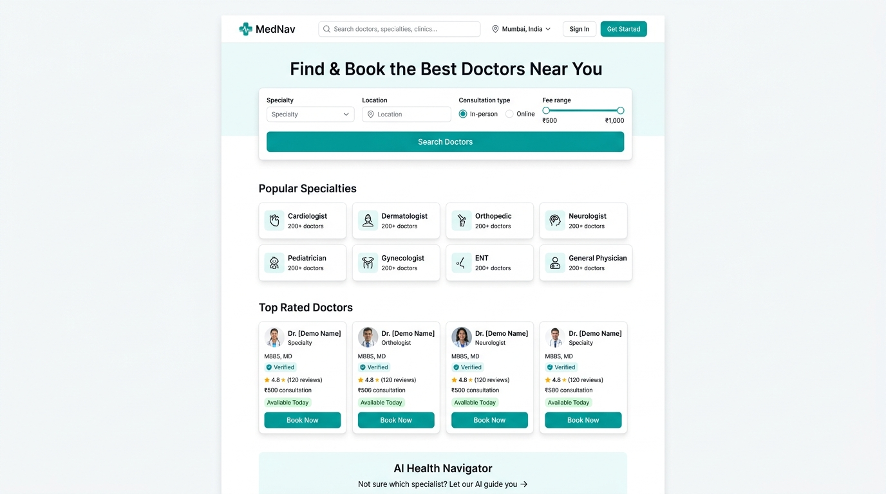
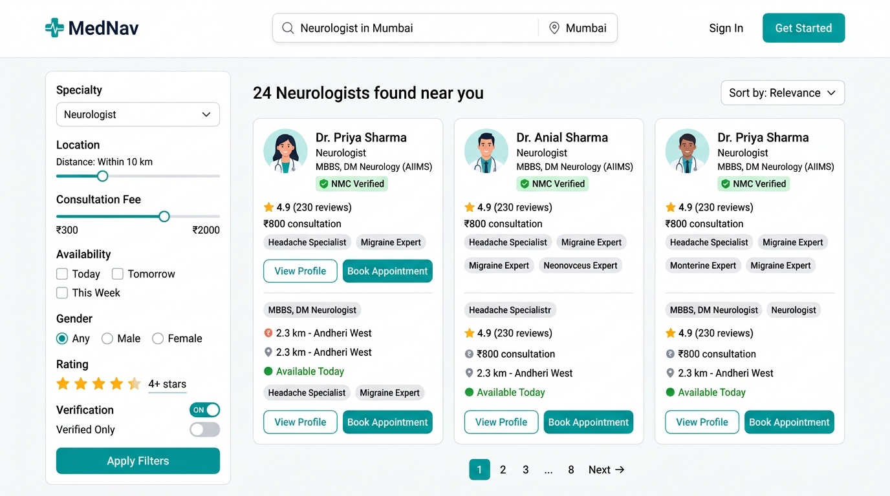
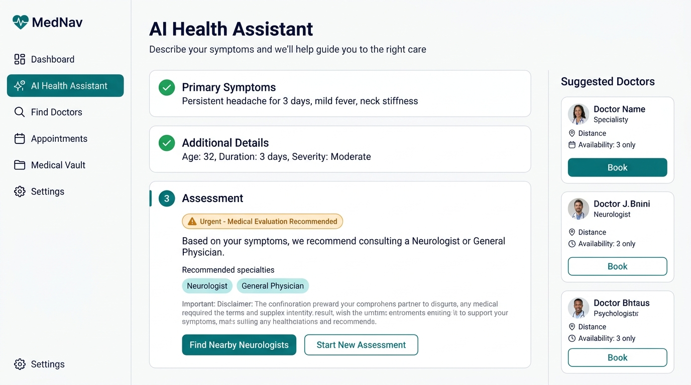
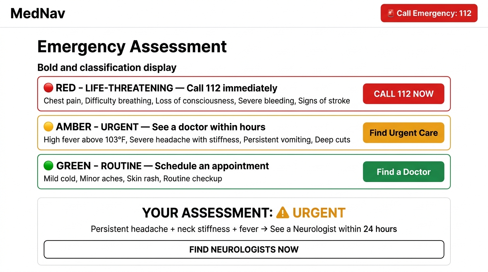
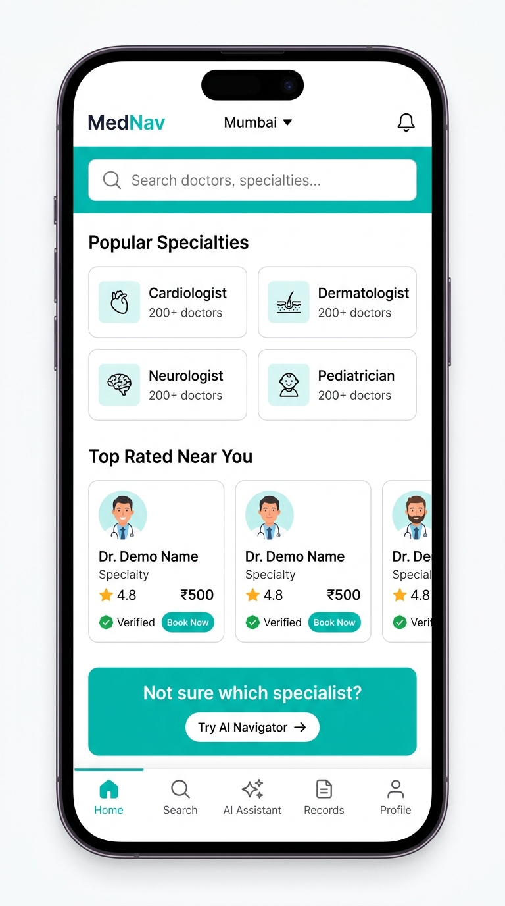

# 🏥 HealthBridge

> **Right Care. Right Doctor. Right Information. Right Time.**  
> An AI-Powered Emergency Healthcare Navigation & Personal Medical Record Platform engineered for accessible, trustworthy digital healthcare in India.

---

[](https://nextjs.org/)
[](https://react.dev/)
[](https://www.typescriptlang.org/)
[](https://tailwindcss.com/)
[](https://aistudio.google.com/)
[](https://vercel.com/)

---

## 📸 Visual Showcase & Platform Previews

### 1. Modern Healthcare Marketplace Homepage

*Marketplace hero with real-time doctor search, location picker (Mumbai), popular specialty pills, top-rated verified doctors, and emergency quick-access.*

---

### 2. Verified Doctor Discovery & Smart Filtering

*Filter specialists by category, consultation fee slider (₹200–₹1,500), minimum star rating, "Verified Only", and "Available Today" status.*

---

### 3. AI Health Navigator & Patient Dashboard

*2-Way Conversational AI Health Navigator powered by Google Gemini 3.5 Flash with strict health guardrails, emergency red-flag triggers, and personal health vault.*

---

### 4. Emergency Care & Nearby Trauma Centers

*One-tap national helplines (112, 108, 102, 14416), critical red-flag checklist, and 24/7 Level 1 Trauma Center casualty departments in Mumbai.*

---

### 5. Mobile-First Experience

*Fully responsive on smartphone viewports with touch-friendly navigation, quick emergency dialing, and collapsible bottom sheets.*

---

## 🎯 The 4 Core Problems HealthBridge Solves

| # | Problem in Healthcare | HealthBridge Solution |
|---|---|---|
| **1** | **Specialist Mismatch**<br>Patients frequently visit the nearest clinic without knowing if the doctor has the appropriate domain specialty, causing repeated visits and delayed diagnosis. | **AI Specialist Matchmaker**<br>Analyzes symptoms naturally to guide users directly to verified specialists (Cardiologists, Neurologists, etc.) best suited for their exact complaint. |
| **2** | **Difficulty Finding Verified Specialists**<br>Patients struggle to verify genuine State Medical Council registrations, qualifications, and transparent consultation fees. | **NMC Verification System**<br>Doctors feature validated State Medical Council registration credentials and clear verification badges. |
| **3** | **Fragmented Medical History**<br>Prescriptions and lab records are scattered across paper files and clinic silos, unavailable during critical decisions. | **Consent-Based Medical Vault**<br>Centralized digital record locker with time-bound (24h/72h) doctor sharing tokens that patients can grant or revoke anytime. |
| **4** | **Delayed Healthcare Decisions**<br>Patients struggle to assess whether subtle symptoms require an emergency room, an urgent clinic visit, or home monitoring. | **2-Way Conversational Triage**<br>Evidence-based AI dialogue with immediate emergency red-flag detection prioritizing 112 dispatch protocols. |

---

## 🌟 Key Platform Features

### 1. 🤖 2-Way Conversational AI Health Navigator (Google Gemini API)
- **Live Integration:** Powered by Google AI Studio's `gemini-3.5-flash` via a secure server route (`/api/chat`).
- **Strict Health-Only Mode:** Explicit system instructions strictly restrict conversations to human health and medical symptoms. Any unrelated non-health queries (e.g., coding, finance, sports, homework) are politely declined.
- **Personalized Dialogue:** Addresses patients with clinical empathy, asking relevant follow-up questions regarding pain intensity, location, and duration.
- **Emergency Priority Guardrails:** Critical symptoms (severe chest pain, breathing failure, stroke symptoms) immediately trigger high-priority alerts with direct **112 / 108** dialing.
- **Resilient Fallback:** Automatically switches to an offline clinical rule engine if external network access is unavailable.

### 2. 🔍 Doctor Discovery & Interactive Booking Flow
- **Multi-parameter Search:** Search by doctor name, specialty, clinic, or medical condition.
- **Interactive Filters:** Filter by specialty, fee slider, rating, verified credentials, and walk-in availability.
- **Doctor Profiles (`/doctor/[id]`):** Complete qualifications, NMC registration details, clinic timings, and patient reviews.
- **Simulated Appointment Booking:** 7-day calendar picker, morning/afternoon/evening time slots, and instant booking confirmation.

### 3. 🔒 Personal Medical Vault & Consent Architecture
- **Categorized Document Storage:** Prescriptions, lab reports, previous consultations, and allergy records.
- **Document Upload Simulator:** Drag-and-drop file upload with category selection and progress feedback.
- **Consent-Based Sharing:** Doctors cannot access records without explicit patient authorization. Access tokens automatically expire after 24–72 hours with instant patient revocation support.

### 4. 👥 Role-Based Portals (`/dashboard`)
- **👤 Patient Dashboard (`/dashboard/patient`):** Vitals summary (BP, Heart Rate, SpO2), scheduled appointments, active medication timings, critical allergy alert box, and pending consent requests.
- **🩺 Doctor Workspace (`/dashboard/doctor`):** Patient consultation queue, pre-consultation AI triage summaries, availability toggle, consultation fee editor, and authorized vault records.
- **🛡️ Administrator Panel (`/dashboard/admin`):** Doctor application verification queue with credential document checks, approval/rejection actions, and tamper-evident consent security audit logs.
- **⚡ 1-Click Evaluator Login (`/auth/login`):** Instant demo login buttons for Patient, Doctor, and Admin roles for seamless presentations.

### 5. 🚨 Emergency Helplines & Trauma Center Finder (`/emergency`)
- **24/7 National Helplines:** 112 (National Emergency), 108 (Ambulance), 102 (Maternal/Child), 1075 (Health Helpline), 14416 (Tele-MANAS Mental Health).
- **Red-Flag Symptom Checklist:** Acute chest pain, FAST stroke signs, breathing distress, and major trauma.
- **Nearby Trauma Centers (Mumbai):** Real-time distance, transit estimates, ICU bed availability, and casualty hotline numbers for KEM Hospital, Lilavati Hospital, Hinduja Hospital, and Kokilaben Hospital.

---

## 🏗️ Clean Project Architecture

```
healthbridge/
├── .env.example                  # Template for environment variables (tracked)
├── .env.local                    # Secret API keys (ignored by git)
├── .gitignore                    # Git ignore rules protecting secret tokens
├── package.json                  # Dependencies & npm scripts
├── tsconfig.json                 # TypeScript compiler options
├── vercel.json                   # Vercel deployment configuration
├── public/                       # Static public assets
│   ├── screenshots/              # High-resolution platform previews for GitHub
│   │   ├── hero_marketplace.jpg
│   │   ├── doctor_discovery.jpg
│   │   ├── ai_triage_dashboard.jpg
│   │   ├── emergency_navigation.jpg
│   │   └── mobile_experience.jpg
│   └── favicon.ico
└── src/
    ├── app/                      # Next.js 16 App Router
    │   ├── layout.tsx            # Root layout with ThemeProvider & SEO metadata
    │   ├── globals.css           # Design system tokens, variables & animations
    │   ├── page.tsx              # Modern Healthcare Marketplace Homepage
    │   ├── find-doctors/         # Doctor discovery with filters & sorting
    │   ├── doctor/[id]/          # Doctor profile & interactive slot booking
    │   ├── ai-assistant/         # 2-Way Conversational AI Health Navigator
    │   ├── medical-vault/        # Personal health records & consent sharing
    │   ├── emergency/            # Emergency helplines & trauma centers
    │   ├── about/                # Problem statements, architecture & disclaimers
    │   ├── dashboard/            # Portals hub
    │   │   ├── page.tsx          # Role selection launchpad
    │   │   ├── patient/page.tsx  # Patient health dashboard & vitals
    │   │   ├── doctor/page.tsx   # Doctor consultation queue & schedule
    │   │   └── admin/page.tsx    # Doctor verification & consent audit logs
    │   ├── auth/                 # Authentication & 1-click evaluator login
    │   │   ├── login/page.tsx
    │   │   ├── signin/page.tsx
    │   │   └── signup/page.tsx
    │   └── api/
    │       └── chat/route.ts     # Secure server route for Google Gemini API
    ├── components/               # Modular UI Components
    │   ├── Navbar.tsx            # Sticky navbar with search, location & theme toggle
    │   ├── Footer.tsx            # Comprehensive navigation, emergency bar & disclaimers
    │   ├── DoctorCard.tsx        # Reusable doctor card with badges & booking CTA
    │   └── ThemeProvider.tsx     # Light & dark theme provider (next-themes)
    └── lib/                      # Business Logic & Data
        ├── mockData.ts           # Demo models for doctors, appointments, records & centers
        └── clinicalTriage.ts     # Modular clinical rule engine & offline triage fallback
```

---

## 💻 Getting Started Locally

### Prerequisites
- [Node.js](https://nodejs.org/) v18.18 or higher (Node 20+ recommended)
- `npm` or `yarn`

### 1. Clone the Repository
```bash
git clone https://github.com/your-username/healthbridge.git
cd healthbridge
```

### 2. Install Dependencies
```bash
npm install
```

### 3. Configure Environment Variables
Copy `.env.example` to `.env.local`:
```bash
cp .env.example .env.local
```

Open `.env.local` and add your Google AI Studio API key:
```env
GEMINI_API_KEY="your_google_ai_studio_api_key_here"
```
*(Get a free key in seconds at [Google AI Studio](https://aistudio.google.com/app/apikey))*

### 4. Run the Development Server
```bash
npm run dev
```

Open [http://localhost:3000](http://localhost:3000) in your browser.

---

## 🚀 Deploy to Vercel (Step-by-Step)

HealthBridge is pre-configured for seamless **1-click deployment on Vercel**:

### Option A: Via Vercel Web Dashboard (Recommended)

1. Push your repository to your GitHub account:
   ```bash
   git add .
   git commit -m "feat: complete HealthBridge AI healthcare platform"
   git branch -M main
   git remote add origin https://github.com/your-username/healthbridge.git
   git push -u origin main
   ```
2. Navigate to [Vercel](https://vercel.com) and click **"Add New..." → "Project"**.
3. Import your **`healthbridge`** repository.
4. In the **Environment Variables** section, add:
   - **Key:** `GEMINI_API_KEY`
   - **Value:** `your_google_ai_studio_api_key_here`
5. Click **"Deploy"**.
6. Vercel will build the Next.js production bundle and generate your live production URL (e.g., `https://healthbridge.vercel.app`).

### Option B: Via Vercel CLI
```bash
npm i -g vercel
vercel
```

---

## 🧪 Production Build Verification

To verify that the production bundle compiles with zero errors before pushing:
```bash
npm run build
```
Expected output:
```
✓ Compiled successfully
✓ Running TypeScript ... Finished in 2.4s
✓ Generating static pages (19/19)
○  (Static)             prerendered as static content
◐  (Partial Prerender)  prerendered as static HTML
ƒ  (Dynamic)            server-rendered on demand (/api/chat)
```

---

## ⚖️ Ethical & Medical Disclaimers

1. **Demonstration & Educational Prototype:** HealthBridge is designed and built for college mini-project evaluation and academic demonstration in digital healthcare and medical informatics.
2. **Not Medical Advice:** The AI Health Navigator provides educational symptom guidance and care-navigation suggestions only. It is not an autonomous physician and does not independently diagnose medical conditions or prescribe medications.
3. **Emergency Primacy:** In any life-threatening situation or emergency, users must immediately contact emergency medical services (**112** or **108** in India) or visit the nearest hospital emergency department.
4. **Synthetic Data Notice:** All doctor profiles, clinics, registrations, patient records, and hospital occupancy figures are synthetic demonstration records for UI/UX demonstration.

---

## 📄 License
This project is open-source and available under the [MIT License](LICENSE).
