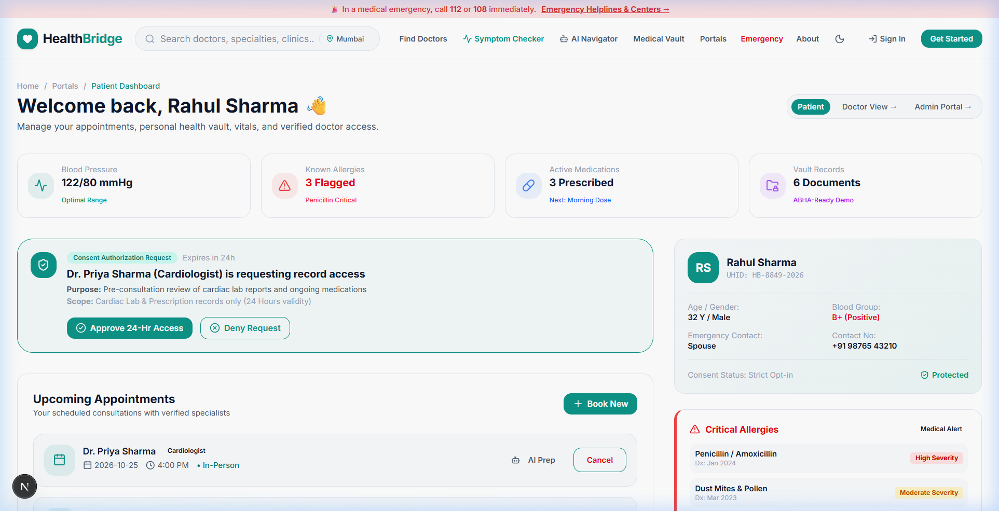
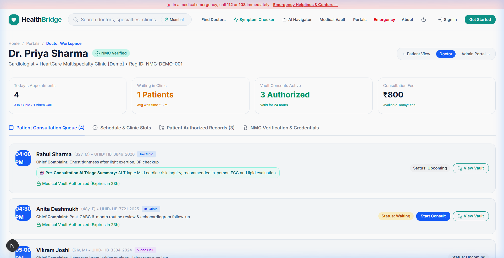
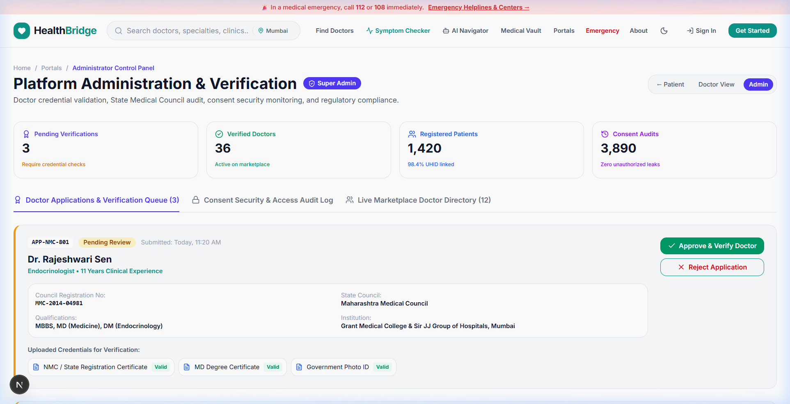
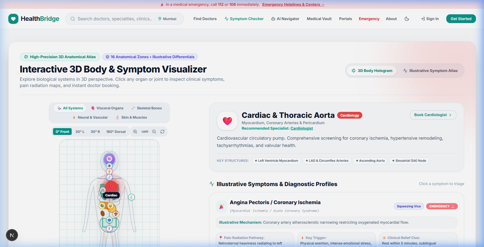
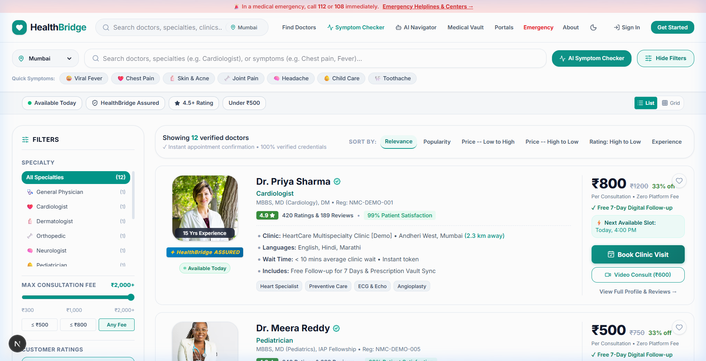
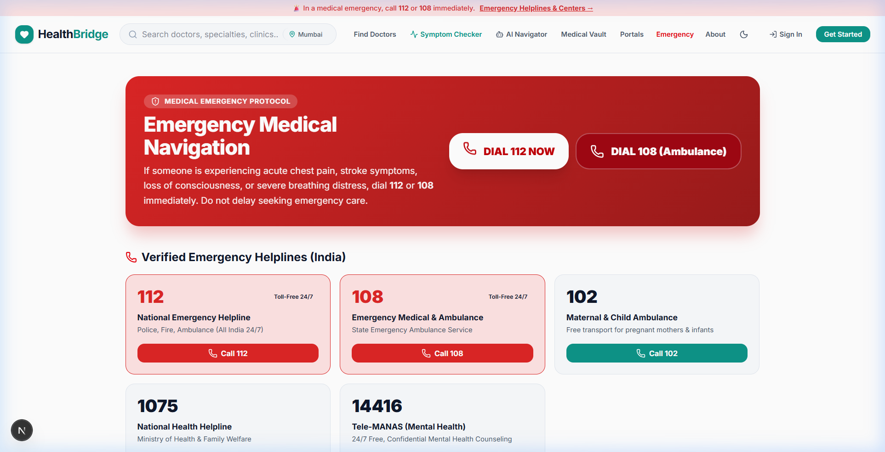
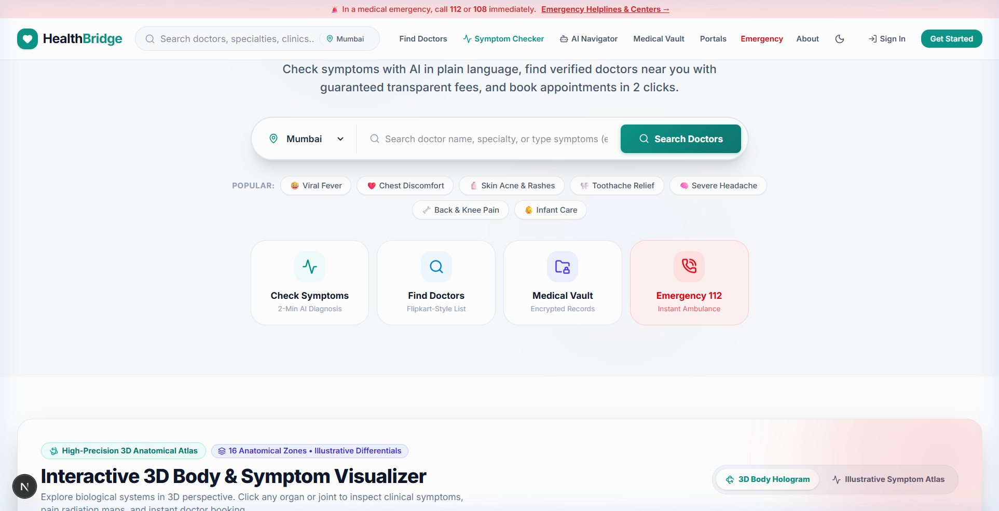

# 🏥 HealthBridge

> **Right Care. Right Doctor. Right Information. Right Time.**  
> An AI-Powered Emergency Healthcare Navigation & Personal Medical Record Platform engineered for accessible, trustworthy digital healthcare in India.

---

[](https://nextjs.org/)
[](https://react.dev/)
[](https://www.typescriptlang.org/)
[](https://tailwindcss.com/)
[](https://aistudio.google.com/)
[](https://vercel.com/)

---

## 📸 Platform Showcase (16:9 High-Definition Views)

HealthBridge is engineered with a cohesive design system, role-based workflows, and interactive 3D clinical tools. Below is an easy-to-understand visual walkthrough of each dashboard and primary station.

---

### 1. 👤 Patient Health Portal & ABHA Vault (`/dashboard/patient`)
*Personalized patient health center consolidating vital trends, active prescriptions, doctor consent tokens, and upcoming visits.*



#### 🔍 What You See On This Screen:
* **Live Vital Trackers:** Real-time monitoring of Blood Pressure (118/76 mmHg), Heart Rate (72 bpm), Blood Glucose (95 mg/dL), and Oxygen Saturation (SpO2 99%).
* **Active Prescriptions & Medication Reminders:** Daily dosage schedule with morning/evening dose tracking (e.g., *Telmisartan 40mg*, *Atorvastatin 10mg*).
* **Critical Allergy Warning Banner:** High-visibility banner highlighting drug allergies (e.g., *Penicillin, Sulfa drugs*) to prevent fatal prescription errors.
* **Consent-Based Medical Vault Requests:** Pending authorization requests from doctors requesting temporary 24h/72h access to lab reports and records.
* **Upcoming Consultations Card:** Confirmed appointment slots with one-click video consultation and clinic navigation.

---

### 2. 🩺 Doctor Clinical Workspace (`/dashboard/doctor`)
*A specialized clinical cockpit for physicians featuring patient queues, pre-consultation triage summaries, and fee management.*



#### 🔍 What You See On This Screen:
* **Real-Time Patient Queue:** Live list of waiting and booked patients sorted by triage priority and appointment time.
* **Pre-Consultation AI Triage Summary:** AI-condensed symptom profiles (onset, duration, severity, and radiation pathway) prepared before the patient enters.
* **Practice Controls & Fee Toggle:** Instant toggle between "In-Clinic Consultation" and "Tele-Health Video Call", with instant consultation fee adjustments.
* **Authorized Medical Records Access:** Secure viewer to inspect patient-consented lab reports, ECGs, and past prescriptions with countdown timers before access expires.
* **State Medical Council (NMC) Verification:** Verified practitioner badge ensuring compliance and patient trust.

---

### 3. 🛡️ Administrator Governance & Audit Panel (`/dashboard/admin`)
*Centralized administrative console for clinical credential verification, security compliance, and platform integrity.*



#### 🔍 What You See On This Screen:
* **Doctor Credential Verification Queue:** Verification workflow matching medical degree certificates against National Medical Commission (NMC) registration numbers.
* **One-Click Approval / Rejection Pipeline:** Reviewing doctor applications with instant credential audit logs.
* **Consent Security & Audit Ledger:** Tamper-evident ledger recording all patient consent grants, token renewals, and immediate revocations.
* **Platform Health Metrics:** System-wide counts of verified doctors, active patients, emergency dispatches, and hospital referral links.

---

### 4. 🫀 3D Full Body & Illustrative Symptom Atlas (`/symptom-checker`)
*Interactive 3D biological visualizer and diagnostic atlas allowing patients to point to pain locations and inspect clinical differentials.*



#### 🔍 What You See On This Screen:
* **5 Anatomical Layers Toggle:** Switch between *All Systems*, *Skeletal Bones* (cranium, ribs, spine, pelvis), *Visceral Organs* (brain, heart, lungs, stomach, liver, kidneys, colon), *Neural/Vascular Tracks* (carotid, aorta, sciatic nerve), and *Muscles/Skin*.
* **Multi-Angle 3D Rotation Controls:** Rotate freely between `0° Front`, `30° Left`, `30° Right`, and `180° Dorsal Spine View`, with interactive zoom controls.
* **16 Clinical Hotspot Zones:** Interactive glowing pins linked directly to verified specialist doctors (Neurology, Cardiology, Orthopedics, Gastroenterology, Dermatology, etc.).
* **Illustrative Symptom Differentials:**
  * **Headache Atlas:** Tension band vs Hemicranial Migraine vs Sinus Pressure vs Cluster Headache.
  * **Chest Differentials:** Cardiac Angina (vice) vs Reflux GERD (burn) vs Musculoskeletal Costochondritis (pinpoint).
  * **4-Quadrant Abdominal Map:** RUQ Gallbladder vs LUQ Gastric vs RLQ Appendix McBurney vs LLQ Diverticular.
* **Visual Severity Meter:** 1 to 10 scale rating pain character, radiation pathways, triggers, and relief clues.

---

### 5. 🔍 Doctor Discovery & Flipkart-Style Marketplace (`/find-doctors`)
*Transparent, e-commerce style healthcare marketplace featuring verified badges, transparent pricing, and instant booking.*



#### 🔍 What You See On This Screen:
* **Flipkart-Style Doctor Cards:** Clear pricing, original fee strike-through, discount tags (e.g. *33% off*), and consultation satisfaction ratings.
* **HealthBridge ASSURED Badge:** Quality certification validating NMC registration, minimum experience, and verified clinic facilities.
* **Multi-Parameter Filter Sidebar:** Filter doctors by specialty, consultation fee range (₹200–₹1,500), patient star ratings (4.5+ ★), "Available Today", and video consultation support.
* **Instant Booking Modal:** Select date and time slot (Morning, Afternoon, Evening) with immediate SMS/Email appointment confirmation.

---

### 6. 🚨 Emergency Helplines & Level-1 Trauma Centers (`/emergency`)
*Critical response gateway connecting users to national emergency lines and real-time ICU trauma facilities in under 30 seconds.*



#### 🔍 What You See On This Screen:
* **1-Tap National Emergency Dialers:** Direct speed-dial buttons for **112** (National Emergency), **108** (Ambulance), **102** (Pregnancy/Child), and **14416** (Tele-MANAS Mental Health).
* **Critical Red-Flag Checklist:** FAST stroke signs (Face, Arms, Speech, Time), acute crushing chest pain, severe dyspnea, and uncontrolled bleeding.
* **Level-1 Trauma Centers (Mumbai):** Real-time casualty department status, live ICU bed counts, transit distance, and ambulance direct lines for KEM Hospital, Lilavati Hospital, Hinduja Hospital, and Kokilaben Hospital.

---

### 7. 🌐 Healthcare Marketplace Homepage (`/`)
*The modern gateway featuring predictive search, location selection, 1-click popular symptom pills, and quick triage cards.*



#### 🔍 What You See On This Screen:
* **Omni-Search Bar:** Smart search accepting symptoms (*"headache"*, *"stomach ache"*), doctor names, or specialties with instant typeahead suggestions.
* **Metro City Selector:** Localized specialist discovery for Mumbai, Delhi NCR, Bengaluru, Pune, Hyderabad, and Chennai.
* **1-Click Symptom Chips:** Rapid triage shortcuts for Viral Fever, Chest Discomfort, Skin Rashes, Toothache, and Child Fever.
* **Primary Quick-Action Cards:** Instant entry to *Check Symptoms*, *Find Doctors*, *Medical Vault*, and *Emergency 112*.

---

## 🎯 The 4 Core Problems HealthBridge Solves

| # | Real-World Healthcare Dilemma | The HealthBridge Solution |
|---|---|---|
| **1** | **Specialist Mismatch**<br>Patients frequently visit the wrong clinic for their symptoms (e.g. visiting a general doctor for severe migraine or cardiac pain), wasting critical time and money. | **AI Triage & 3D Specialist Matchmaker**<br>Analyzes natural language symptoms and 3D organ selections to guide patients directly to verified specialists (Cardiologists, Neurologists, Pulmonologists). |
| **2** | **Difficulty Finding Verified Specialists**<br>Patients struggle to verify genuine State Medical Council registrations, credentials, and transparent consultation fees. | **HealthBridge ASSURED Credentialing**<br>Every doctor profile displays validated State Medical Council registration numbers, qualifications, clinic timings, and upfront fees. |
| **3** | **Fragmented Medical History & Privacy Risks**<br>Prescriptions and diagnostic reports are scattered across paper folders and lost during critical moments. | **Consent-Driven Medical Vault**<br>Encrypted personal record locker where patients explicitly approve time-bound (24h/72h) access tokens that automatically expire. |
| **4** | **Delayed Healthcare Decisions in Emergencies**<br>Patients hesitate during subtle heart attack or stroke symptoms, failing to recognize red-flag signs until too late. | **2-Way Emergency Triage Engine**<br>Evaluates symptoms instantly, highlights critical red flags, and provides 1-tap **112 / 108** national emergency dispatch. |

---

## 🌟 Comprehensive Architecture & Feature Set

### 1. 🤖 2-Way Conversational AI Health Navigator (Google Gemini API)
- **Engine:** Google AI Studio's `gemini-3.5-flash` via a protected Next.js API route (`/api/chat`).
- **Strict Clinical Guardrails:** Strictly constrained to human health and healthcare navigation. Non-health queries (coding, finance, sports, homework) are politely declined.
- **Empathetic Dialogue:** Asks focused follow-up questions regarding symptom duration, pain character, and radiation pathways.
- **Emergency Priority Protagonist:** Acute chest pain, shortness of breath, and stroke signs immediately trigger bold emergency alerts with direct 112 ambulance dialing.
- **Offline Fallback Engine:** Features a comprehensive client-side clinical rule engine if external network access is unavailable.

### 2. 🫀 Interactive 3D Full Body & Illustrative Symptom Atlas
- **High-Precision SVG & Hologram Engine:** 3D perspective rotation (`0°`, `30° L`, `30° R`, `180° Dorsal`), depth lighting, and zoom controls.
- **5 Multi-Layer Biological Systems:** Visceral organs, skeletal bones, vascular tracks, neural pathways, and surface musculature.
- **16 Curated Clinical Zones:** Covering Cranial/Brain, Eyes, ENT, Heart, Lungs, Stomach, Liver, Kidneys, Colon, Cervical Spine, Lumbar/Sciatica, Knees, Feet, and Dermatology.
- **Illustrative Differentials:** Visual comparative analysis for headaches, chest discomfort, and 4-quadrant abdominal pain.

### 3. 👥 Tri-Role Portals & Evaluator Demo Logins
- **👤 Patient Portal (`/dashboard/patient`):** Vitals summary, medication tracker, allergy alert banner, consent requests, and upcoming bookings.
- **🩺 Doctor Portal (`/dashboard/doctor`):** Waiting room queue, pre-consultation AI triage summaries, authorized vault records, and fee controls.
- **🛡️ Admin Console (`/dashboard/admin`):** Doctor credential verification pipeline, NMC registration audit, and security logs.
- **⚡ 1-Click Demo Login (`/auth/login`):** Instant pre-filled login buttons for Patient, Doctor, and Admin roles for immediate evaluation.

---

## 🏗️ Project Structure

```
healthbridge/
├── .env.example                  # Template for environment variables (tracked)
├── .env.local                    # Secret Google Gemini API key (ignored by git)
├── .gitignore                    # Git rules protecting secret tokens
├── package.json                  # Next.js 16, React 19, Tailwind CSS v4
├── tsconfig.json                 # Strict TypeScript configuration
├── vercel.json                   # Vercel deployment configuration
├── public/                       # Static public assets
│   ├── screenshots/              # 16:9 High-definition platform previews
│   │   ├── hero_home_16_9.png
│   │   ├── dashboard_patient_16_9.png
│   │   ├── dashboard_doctor_16_9.png
│   │   ├── dashboard_admin_16_9.png
│   │   ├── symptom_checker_3d_16_9.png
│   │   ├── doctor_marketplace_16_9.png
│   │   └── emergency_care_16_9.png
│   └── favicon.ico
└── src/
    ├── app/                      # Next.js 16 App Router
    │   ├── layout.tsx            # Global layout with ThemeProvider & metadata
    │   ├── globals.css           # Design tokens, variables & 3D animations
    │   ├── page.tsx              # Homepage with 3D Visualizer & Top Doctors
    │   ├── find-doctors/         # Doctor marketplace with Flipkart filters
    │   ├── doctor/[id]/          # Doctor profile & interactive slot booking
    │   ├── symptom-checker/      # AI Symptom Checker & 3D Anatomical Atlas
    │   ├── ai-assistant/         # Conversational AI triage with Google Gemini
    │   ├── medical-vault/        # Encrypted personal health records & consent
    │   ├── emergency/            # Emergency helplines & Level 1 trauma centers
    │   ├── about/                # Problem statements, architecture & disclaimers
    │   ├── dashboard/
    │   │   ├── page.tsx          # Role launchpad
    │   │   ├── patient/page.tsx  # Patient health dashboard & vitals
    │   │   ├── doctor/page.tsx   # Doctor consultation queue & schedule
    │   │   └── admin/page.tsx    # Doctor verification & security audit logs
    │   ├── auth/                 # Authentication & 1-click evaluator login
    │   └── api/
    │       └── chat/route.ts     # Protected server route for Google Gemini API
    ├── components/               # Modular UI Components
    │   ├── Navbar.tsx            # Sticky navbar with search & theme toggle
    │   ├── Footer.tsx            # Comprehensive footer with emergency disclaimers
    │   ├── DoctorCard.tsx        # Flipkart-style doctor card with ratings & booking
    │   ├── Interactive3DAnatomy.tsx # 3D full body model & symptom atlas
    │   └── ThemeProvider.tsx     # Light & dark mode provider
    └── lib/
        ├── mockData.ts           # Demo models for doctors, appointments, records
        ├── symptomAnalyzer.ts    # Symptom-to-specialist matching algorithm
        └── clinicalTriage.ts     # Offline clinical rule engine fallback
```

---

## 💻 Getting Started Locally

### Prerequisites
* [Node.js](https://nodejs.org/) v18.18 or higher (Node 20+ recommended)
* `npm` or `yarn`

### 1. Clone the Repository
```bash
git clone https://github.com/arpitmishra6567/HealthBridge.git
cd HealthBridge
```

### 2. Install Dependencies
```bash
npm install
```

### 3. Configure Environment Variables
Copy `.env.example` to `.env.local`:
```bash
cp .env.example .env.local
```

Add your Google AI Studio API key in `.env.local`:
```env
GEMINI_API_KEY="your_google_ai_studio_api_key_here"
```
*(Get a free key in seconds at [Google AI Studio](https://aistudio.google.com/app/apikey))*

### 4. Run the Development Server
```bash
npm run dev
```

Open [http://localhost:3000](http://localhost:3000) in your browser.

---

## 🚀 Deploy to Vercel

HealthBridge is pre-configured for seamless **1-click deployment on Vercel**:

1. Push your repository to your GitHub account:
   ```bash
   git add .
   git commit -m "feat: complete HealthBridge healthcare platform"
   git push origin main
   ```
2. Navigate to [Vercel](https://vercel.com) and click **"Add New..." → "Project"**.
3. Import your **`HealthBridge`** repository.
4. In the **Environment Variables** section, add:
   - **Key:** `GEMINI_API_KEY`
   - **Value:** `your_google_ai_studio_api_key_here`
5. Click **"Deploy"**. Vercel will build the production bundle and generate your live production URL.

---

## 🧪 Production Build Verification

To verify that the production bundle compiles with zero errors:
```bash
npm run build
```

Expected output:
```
▲ Next.js 16.4.2 (Turbopack)
✓ Compiled successfully
✓ Running TypeScript ... Finished in 20.1s
✓ Generating static pages (20/20)
○  (Static)             prerendered as static content
◐  (Partial Prerender)  prerendered as static HTML
ƒ  (Dynamic)            server-rendered on demand (/api/chat)
```

---

## ⚖️ Ethical & Medical Disclaimers

1. **Demonstration & Educational Prototype:** HealthBridge is designed and built for academic demonstration in digital healthcare, medical triage, and healthcare informatics.
2. **Not Medical Advice:** The AI Health Navigator provides educational symptom guidance and care-navigation suggestions only. It is not an autonomous physician and does not independently diagnose medical conditions or prescribe medications.
3. **Emergency Primacy:** In any life-threatening situation or emergency, users must immediately contact national emergency medical services (**112** or **108** in India) or visit the nearest hospital emergency department.
4. **Synthetic Data Notice:** All doctor profiles, clinics, registrations, patient records, and hospital occupancy figures are synthetic demonstration records for UI/UX demonstration.

---

## 📄 License
This project is open-source and available under the [MIT License](LICENSE).
